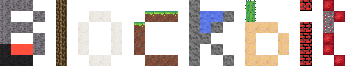
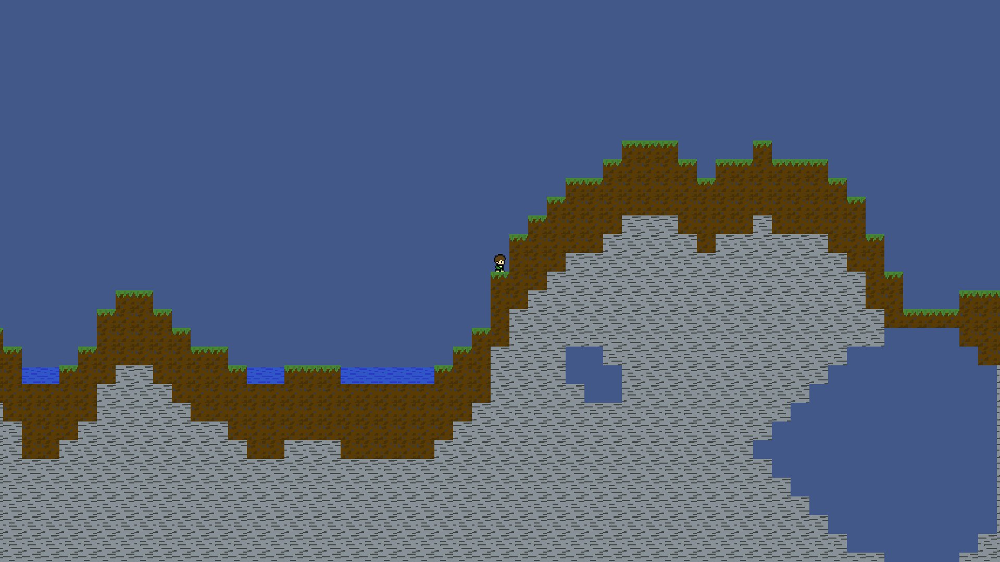

---

A 2D sandbox game written in **C++20** with **SFML**, inspired by classic block-based games. Dig, build, craft, fight — survive your own world, or share it with friends over the network.


---

## The game

Blockbit drops you into an infinite, side-scrolling world made of blocks. Terrain is streamed in around you as you explore — there is no edge, only a soft world border far from spawn. Every block you see can be mined with the right tool and stacked back somewhere else.

### World

- **Procedural generation** with three selectable world types:
  - **Normal** — rolling terrain with caves, ores, trees, biomes and surface features.
  - **Flat** — a clean canvas for building.
  - **Dungeon Shooter** — a denser, combat-oriented layout.
- **Day / night cycle** with a lighting shader that drives ambient brightness, sunlight through blocks, and local light sources.
- **Dynamic fluids** — water flows and settles, lava burns, fire spreads and consumes flammable blocks.
- **Physics-driven blocks** — sand and gravel fall, explosives detonate and leave craters.
- **Persistent worlds** stored on disk in a compact binary format (BBT) — leave, come back, nothing changes.

### Blocks, items, crafting

- Dozens of block types: stone, grass, dirt, cobblestone, obsidian, sand, snow, gravel, cactus, bricks, bedrock, chests, furnaces, workbenches, and more.
- A full tool progression (**wood → stone → iron → gold → diamond**) across pickaxes, axes and shovels. Each block has a required mining tool and tier; using the wrong one is slow or drops nothing.
- **Workbench** for crafting recipes, **furnace** for smelting ores into ingots (with its own fuel system), **chests** for storage with a server-authoritative UI.
- Consumables, weapons, buckets for picking up fluids, flint & lighter for starting fires, dynamite for blowing holes in the terrain.

### Life in the world

- **Mobs** with AI — passive and hostile — spawn based on light, biome and time of day.
- **Health system** with fall damage, fire damage, drowning, and mob attacks.
- **Server-authoritative actions** — placing, breaking, using items and opening containers all round-trip through the server, so single-player and multiplayer behave identically.

### Multiplayer

- **Host your world** directly from the game — other players join over UDP with a nickname and address.
- **Listen-server architecture**: the host plays and serves at the same time; remote clients see the same world as the host, synced via delta snapshots.
- **In-game chat** with slash commands: `/give`, `/tp`, `/time`, `/kick`, `/ban`/`/unban`, `/op`/`/deop`, `/noclip`, `/entities`, `/say`, `/help`, and more.
- **Dedicated headless server** build for running a persistent world without a graphical client (see below).

### Controls

| Action | Key |
|---|---|
| Move | `A` / `D` |
| Jump | `Space` |
| Mine / attack | Left mouse |
| Place / use | Right mouse |
| Zoom (reach-zoom) | Hold right mouse at distance |
| Drop item | `Q` (hold `Shift` for whole stack) |
| Open inventory | `E` |
| Hotbar slots | `1`–`9` |
| Open chat / command | `T` |
| Pause menu | `Esc` |

---

## Running

```bash
# Launch into the main menu
./build/bin/Blockbit

# Jump straight into a saved world
./build/bin/Blockbit --load MyWorld Nick

# Host a world for others to join
./build/bin/Blockbit --host MyWorld Nick

# Join someone else's server
./build/bin/Blockbit --join 192.168.1.10:25565 Nick
```

Worlds are saved to `~/Blockbit/saves/<name>/` on Linux and `%APPDATA%/Blockbit/saves/<name>/` on Windows.

---

## For developers

### Build

Requirements: C++20 compiler, CMake ≥ 3.16, Ninja, SFML 3.1.x. Dear ImGui, imgui-sfml, nlohmann/json and asio are fetched by CMake; zstd and tinyxml2 come from the system.

```bash
./build.sh                    # Debug build (clang/clang++ by default)
./build.sh release            # Optimized release build
./build.sh rebuild            # Wipe build/ and start over
./build.sh run                # Build and launch
./build.sh run-world MyWorld  # Build and load straight into a world
```

Binary ends up at `build/bin/Blockbit`. On Windows use `build-windows.bat`.

### Headless server

A separate, graphics-free binary (`BlockbitServer`) is available for running a dedicated server. It links no SFML Graphics / Window / Audio and skips all client-only sources.

```bash
./build-headless.sh                           # Release build, stripped
./build-headless/bin/BlockbitServer MyWorld   # Host MyWorld on the default port
```

The headless server reads a `config.json` inside the server directory for port, world name, generation type and max players.

---

## License

This project is licensed under the [MIT License](LICENSE).
